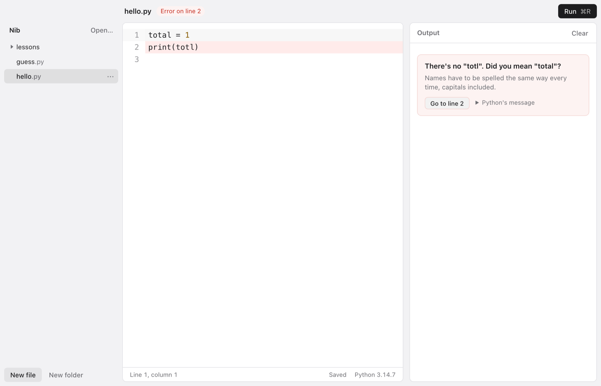
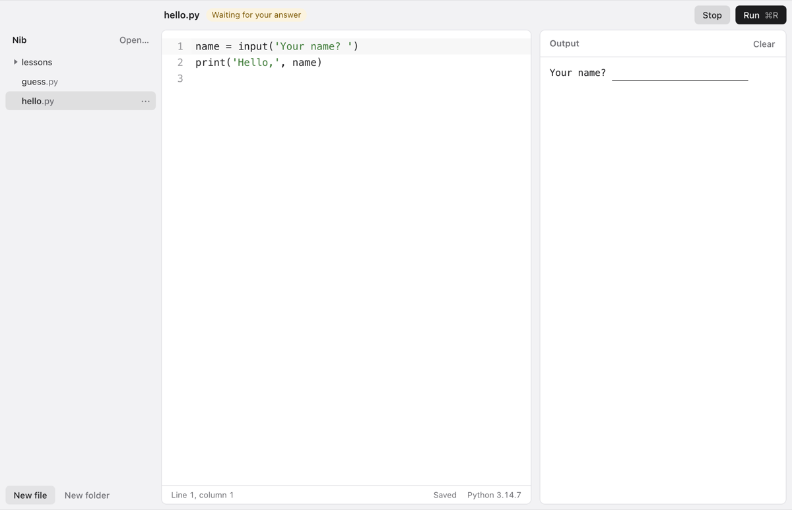
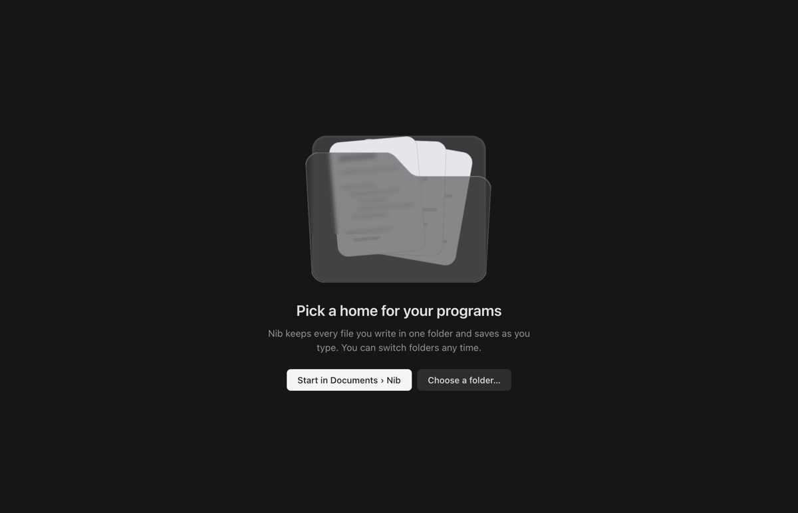

<p align="center">
  
</p>

<h1 align="center">Nib</h1>

<p align="center">
  <b>A calm Python editor for people just starting out.</b><br>
  Type your code, press Run, and read errors in plain English.
</p>

<p align="center">
  <sub>Free and open source &nbsp;·&nbsp; macOS for now &nbsp;·&nbsp; Python 3.14</sub>
</p>

<br>

<picture>
  <source media="(prefers-color-scheme: dark)" srcset="docs/hero-dark.png">
  
</picture>

## Why Nib

You're following a Python course, a book or a video. You need somewhere to type the code and run
it, without setting up an IDE, a terminal and a virtual environment first. That's all Nib is.

- **Errors you can read.** "There's no `totl`. Did you mean `total`?" instead of a traceback. The
  line turns red, and **Go to line** takes you there. Python's own message is one click away.
- **`input()` just works.** When your program asks a question, you answer it in the output, right
  where the question is.
- **Your files are plain files.** Nib keeps your programs in one folder and saves as you type. Open
  them with anything else, any time.
- **Nothing to set up.** No `pip`, no virtual environment, no project settings. Nib runs your code
  with its own Python 3.14, never whatever else is installed on your computer.
- **Small and quick.** The app is about 4 MB, built with [Tauri](https://tauri.app) instead of a
  bundled copy of Chrome. Programs start in a few hundredths of a second.

## Made for the first weeks

<table>
  <tr>
    <td width="50%"></td>
    <td width="50%"></td>
  </tr>
  <tr>
    <td align="center"><sub>Answer your program's questions where it asks them</sub></td>
    <td align="center"><sub>One folder for everything you write, in light or dark</sub></td>
  </tr>
</table>

- **Run** with **⌘R**, **⌘Enter** or **F5**. **Stop** a program that won't end with **⌘.**
- **New file** with **⌘N**. Make folders for each week or chapter, rename files, and move them
  to the Trash from the **⋯** menu.
- **Follows your Mac's light and dark mode.**
- **Calm colours, no blue.** Keywords in rose, text in green and numbers in ochre, so code reads
  easily without shouting.

## Try it

There's no download yet, so for now you build it yourself. You'll need
[Node](https://nodejs.org), [Rust](https://rustup.rs) and [uv](https://docs.astral.sh/uv/).

```bash
uv python install 3.14
npm install
npm run tauri dev
```

> [!NOTE]
> **Early days (0.0.1).** Running code, answering `input()`, the error cards and the file tree all
> work, but expect rough edges. Please [report anything that breaks](https://github.com/anon5376/nib/issues).
>
> **Built with AI.** Most of the code is written by AI coding agents, directed and tested by a human.

<details>
<summary><b>For developers</b></summary>

<br>

- **Stack:** Tauri 2, React 19 and TypeScript in `src/`, Rust in `src-tauri/`, and
  [CodeMirror 6](https://codemirror.net) for editing.
- **Running code:** each run starts a fresh Python with a small harness (`src-tauri/src/runner.py`)
  that streams output and `input()` requests back to the app. Programs run in their own folder,
  so `open("notes.txt")` and importing a neighbouring file behave as they would in a terminal.
- **Files:** every path is checked to stay inside the open folder. Deleting moves to the Trash.
- **Tests:** `npm test`, `cd src-tauri && cargo test`, and `node scripts/ui-check.mjs`, which
  drives the interface in headless Chrome and saves screenshots.
- **Test runs:** set `NIB_FOLDER=<temp folder>` so your own programs are never touched.

</details>

## Credits

The file tree and the welcome folder are adapted from [Rare UI](https://rareui.com) (Bounce
Sidebar and Folder component), rewritten in CSS, under Rare UI's MIT + Commons Clause +
Attribution licence in `src/components/rareui/LICENSE`. Code editing uses
[CodeMirror](https://codemirror.net) (MIT).

## License

[MIT](LICENSE), except the Rare UI files noted above.
